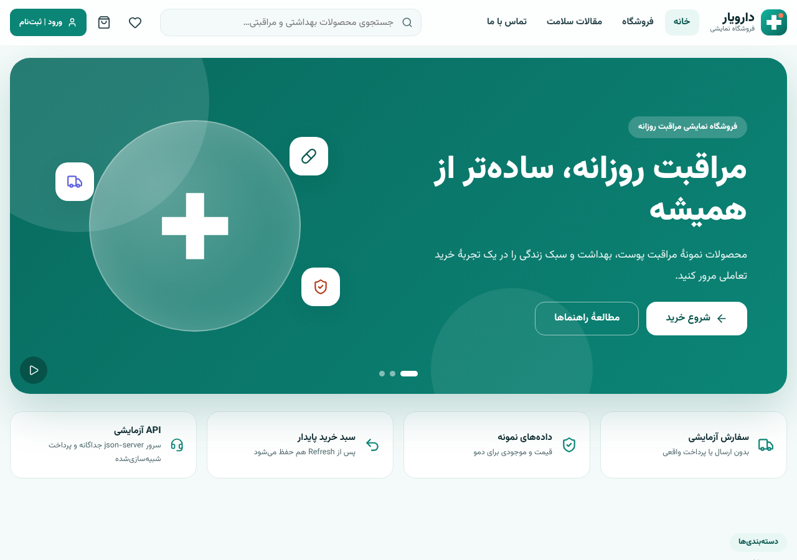
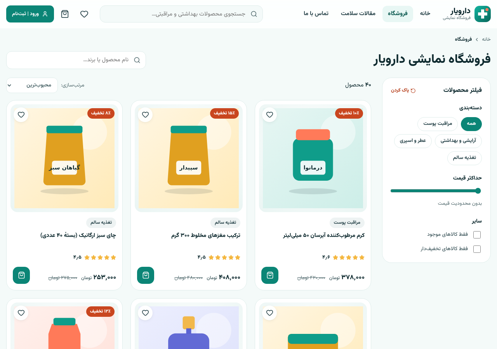
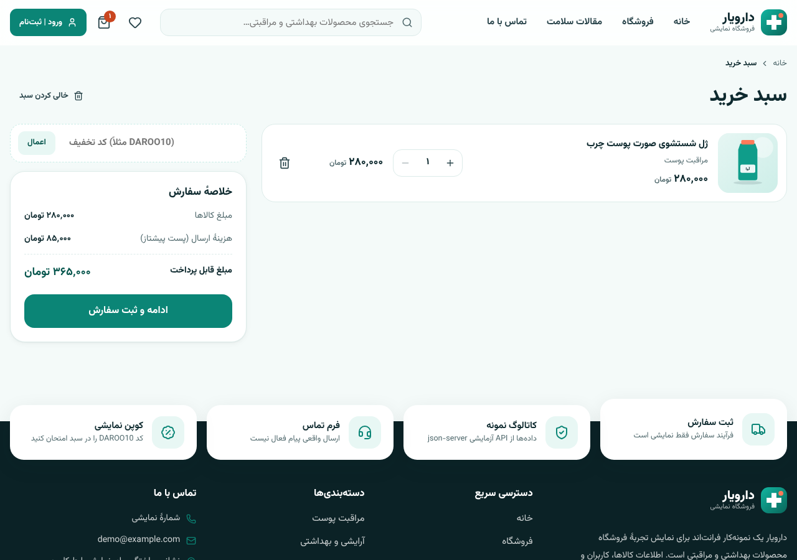
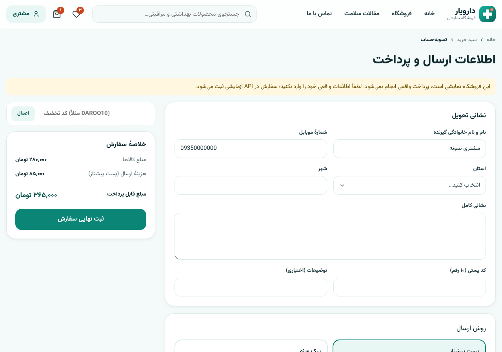
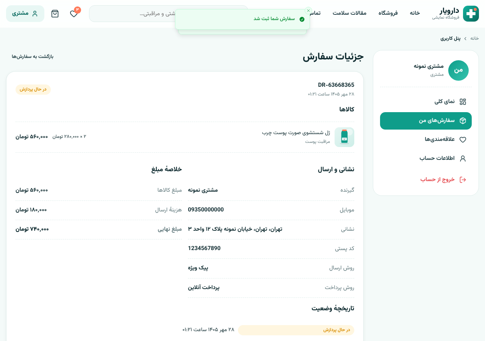
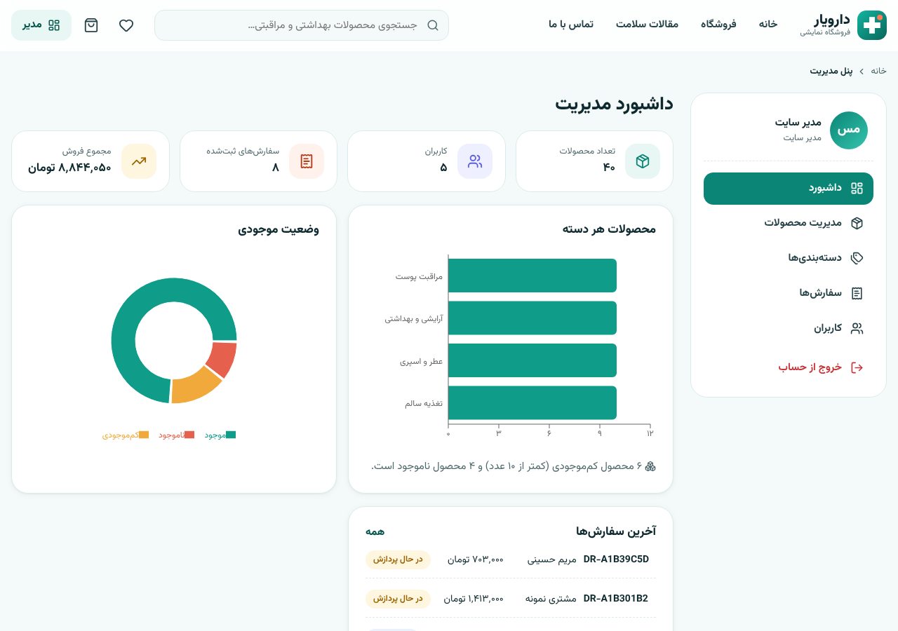
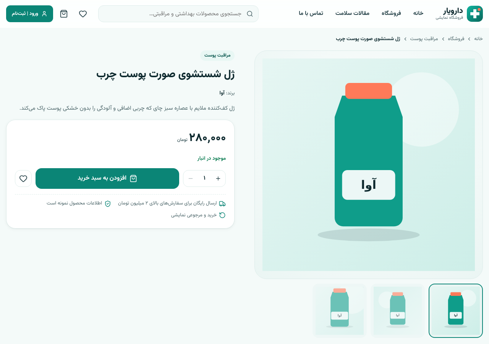
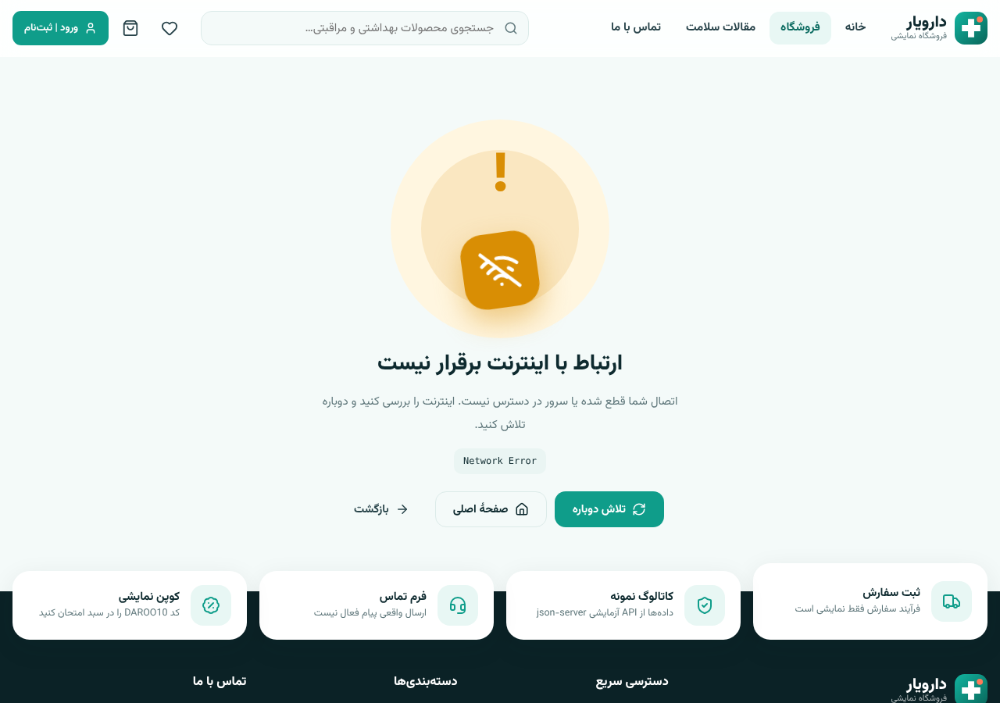

# دارویار — فروشگاه آنلاین (نمونه‌کار React)

نمونه‌کار فرانت‌اند یک فروشگاه محصولات بهداشتی و مراقبتی با React، Vite و رابط فارسی RTL؛ با **API آزمایشی درون مرورگر** (بدون سرور و بدون وابستگی به سرویس خارجی؛ قابل انتشار روی GitHub Pages).

> **نسخهٔ نمایشی:** تمام محصولات، قیمت‌ها، کاربران و سفارش‌ها ساختگی‌اند. پرداخت، ارسال و پشتیبانی واقعی وجود ندارد. اطلاعات شخصی یا گذرواژهٔ واقعی وارد نکنید.

## تصاویر صفحات
| صفحهٔ اصلی | فروشگاه | سبد خرید |
|---|---|---|
|  |  |  |

| تسویه‌حساب | جزئیات سفارش | داشبورد مدیر |
|---|---|---|
|  |  |  |

| جزئیات محصول | موبایل | خطای شبکه |
|---|---|---|
|  |  |  |

## لینک دمو
لینک دمو هنوز منتشر نشده است. برای انتشار: API را روی یک سرویس Node (مثلاً Render) و فرانت را روی Netlify/Vercel مستقر کنید و هنگام build مقدار `VITE_API_URL` را روی نشانی API بگذارید (جزئیات پایین‌تر).

## امکانات
- **فروشگاه:** جست‌وجوی فارسی (یکسان‌سازی «ي/ك»، نیم‌فاصله، «آ/ا» و ارقام فارسی/عربی)، فیلتر هم‌زمان (دسته، حداکثر قیمت، فقط موجود، فقط تخفیف‌دار)، مرتب‌سازی، صفحه‌بندی سمت سرور، پاک کردن فیلترها
- **محصول:** گالری تصویر، قیمت و تخفیف، موجودی، نظرات واقعی مشتریان (ثبت نظر و امتیاز؛ امتیاز محصول از میانگین نظرها محاسبه می‌شود)، محصولات مشابه و حالت «ناموجود» با جایگزین‌های موجود
- **سبد خرید:** افزودن/حذف/تغییر تعداد، ماندگاری پس از Refresh، سبد جدا برای مهمان و هر کاربر (ادغام پس از ورود)، قیمت و موجودی همیشه تازه از API، کوپن (`DAROO10`، `SALAMAT15`)
- **سفارش:** فرم نشانی، روش ارسال (پست/پیک) و پرداخت، بررسی قیمت و موجودی در سرور هنگام ثبت (۴۰۹ با پیام شفاف در صورت تغییر)، کسر موجودی، لغو سفارش با بازگشت موجودی (فقط در مرحلهٔ «در حال پردازش»)، تاریخچه و جزئیات هر سفارش
- **حساب:** ورود/ثبت‌نام با اعتبارسنجی و نمایش خطای سرور روی فیلدها، ویرایش پروفایل، علاقه‌مندی‌ها (سمت سرور؛ برای مدیر غیرفعال است)، پیام‌های من با وضعیت «در انتظار پاسخ / پاسخ داده شد»، جستجوی زنده در نوار بالا، تأیید قبل از خروج، مسیرهای محافظت‌شده، نشست با انقضا (۲ ساعت) و پیام «نشست منقضی شد»
- **پنل مدیریت:** CRUD محصولات با جست‌وجو/فیلتر/صفحه‌بندی، ویرایش سریع موجودی، مدیریت دسته‌بندی، سفارش‌ها (فیلتر وضعیت از جمله «ارسال شده»، جزئیات، تغییر وضعیت با گذارهای مجاز)، پیام‌های تماس (مشاهده و پاسخ)، کاربران، آمار؛ دیالوگ تأیید برای حذف و لغو
- **کاهش فشار روی API:** فقط صفحهٔ جاری از سرور گرفته می‌شود (به‌علاوهٔ پیش‌بارگذاری یک صفحهٔ بعد)؛ هنگام رفتن به صفحهٔ جدید لودر نمایش داده می‌شود. جست‌وجوها همه Debounce دارند (۳۵۰ms)، نتایج در کش React Query می‌مانند و بی‌اعتبارسازی فقط روی کلیدهای مرتبط انجام می‌شود. سبد/کشو تا وقتی باز نشده درخواستی نمی‌زند.
- **ماندگاری وضعیت پس از Refresh:** صفحه، جست‌وجو، فیلتر و مرتب‌سازی (فروشگاه و همهٔ جدول‌های مدیر و سفارش‌های من) و تب محصول در آدرس ذخیره می‌شوند؛ Back/Forward و اشتراک لینک هم همان وضعیت را می‌آورد. شمارهٔ صفحهٔ بیش از حد (`?page=999`) به آخرین صفحهٔ معتبر اصلاح می‌شود.
- **نمودارها:** داشبورد مدیر با Recharts (بارگذاری تنبل برای سبک ماندن بستهٔ اصلی)
- **کیفیت UI:** واکنش‌گرا، اسکلت بارگذاری، صفحهٔ خطای شبکه با «تلاش دوباره»، ۴۰۴ و «محصول پیدا نشد»، دسترس‌پذیری کیبورد و برچسب فرم‌ها، قیمت/تاریخ/اعداد فارسی

## معماری (Feature-based)
```
src/
  app/              routes.jsx — مسیرها، Guardها و lazy loading هر صفحه
  features/         هر قابلیت با لایه‌های خودش (api / hooks / store / components / pages / schemas)
    auth/           ورود، ثبت‌نام، نشست، Guardهای نقش‌ها (User / Admin)
    catalog/        فروشگاه، فیلتر/جست‌وجو/مرتب‌سازی، صفحهٔ محصول
    cart/           سبد، کوپن، تسویه‌حساب
    orders/         ثبت و پیگیری سفارش، جزئیات سفارش
    wishlist/  articles/  contact/  home/
    account/        پنل مشتری
    admin/          پنل مدیریت (محصولات، دسته‌ها، سفارش‌ها، کاربران، آمار)
  shared/           بخش‌های مشترک بین قابلیت‌ها
    api/client.js   کلاینت axios و ApiError یکسان
    components/     common (Button, Fields, Modal…)، layout، feedback، loaders، panel
    hooks/  lib/  schemas/(fields مشترک Zod)  store/  utils/
  styles/index.css  Tailwind CSS v4 (@theme توکن‌ها، انیمیشن‌ها، لایهٔ base)
  mock/             API آزمایشی درون مرورگر (adapter محور axios)
    routes/     احراز هویت، سفارش، کاتالوگ، علاقه‌مندی/پیام‌ها/نظرها/آمار
    lib/        اعتبارسنجی، هش گذرواژه، قیمت‌گذاری، نرمال‌سازی فارسی
    db.js       ذخیرهٔ داده‌ها در localStorage با داده‌های اولیهٔ seed.json
scripts/seed/       تولید seed.json و تصاویر SVG محصولات
```
قاعدهٔ وابستگی: `shared` به هیچ feature ای وابسته نیست؛ featureها فقط از `shared` یا از هوک/کامپوننت‌های عمومی featureهای دیگر استفاده می‌کنند. استایل‌ها با Tailwind در خود JSX هستند و کلاس‌های تکراری در `shared/components/common/styles.js` جمع شده‌اند.

- **API:** پاسخ‌ها کش می‌شوند؛ پس از هر تغییر فقط Queryهای مرتبط باطل می‌شوند (مثلاً ثبت سفارش ⇒ سفارش‌ها + محصولات + آمار). خطاها در `ApiError` یکسان‌سازی و در UI با تلاش دوباره نمایش داده می‌شوند.
- **سبد:** تنها منبع داده `cartStore` است (شناسه + تعداد)؛ نام، قیمت و موجودی از API می‌آید و جمع کل فقط از روی اقلام در `utils/pricing.js` محاسبه می‌شود. سرور همان قواعد را هنگام ثبت سفارش دوباره بررسی می‌کند.
- **قطع اینترنت:** نوار هشدار «اتصال قطع است» (رویدادهای online/offline)؛ React Query درخواست‌ها را تا وصل شدن مجدد نگه می‌دارد و خطاهای شبکه صفحهٔ «تلاش دوباره» دارند.
- **عملکرد:** هر صفحه و بخش‌های پایین صفحهٔ اصلی و نمودارها با `lazy` تقسیم کد می‌شوند، تصاویر `loading="lazy"` دارند و کامپوننت‌های لیست با `memo` از رندر اضافه جلوگیری می‌کنند. حجم بستهٔ اصلی پس از build حدود ۱۵۱KB (gzip) و بستهٔ نمودارها (Recharts) جداگانه و فقط در داشبورد مدیر بارگذاری می‌شود؛ با `npm run build` می‌توانید حجم‌ها را ببینید.
- **امنیت:** ورودی‌ها هم در فرانت (Zod) و هم در سرور اعتبارسنجی می‌شوند؛ مخفی کردن دکمه یا محافظت از Route در فرانت فقط تجربهٔ کاربری است و مجوز واقعی در سرور (نقش‌ها، مالکیت سفارش، ۴۰۳) بررسی می‌شود.
- **فرم‌ها:** React Hook Form + Zod، جلوگیری از ارسال چندباره (دکمهٔ loading)، فوکوس روی اولین خطا.

## اجرا
نیازمند Node.js نسخهٔ `22.22.0` یا بالاتر (در `package.json` و `.nvmrc` هم همین آمده است).
```bash
npm install
npm run dev     # فرانت روی پورت ۵۱۷۳ (API آزمایشی درون مرورگر است)
npm run seed    # بازتولید src/mock/seed.json و تصاویر
npm run build && npm run lint
```
داده‌ها (کاربران، سفارش‌ها، نظرها، پیام‌ها…) در localStorage مرورگر هر بازدیدکننده ذخیره می‌شوند و به دستگاه‌های دیگر منتقل نمی‌شوند. برای بازگرداندن داده‌های اولیه، localStorage سایت را پاک کنید.

## حساب‌های نمایشی
- مشتری: `customer` / `customer123`
- مدیر: `admin` / `admin1234`
- کاربران دیگر: `sara.rad`, `ali.karimi`, `maryam.h` با گذرواژهٔ `demo1234`

## محدودیت‌ها (مهم)
- **بک‌اند واقعی وجود ندارد:** API درون مرورگر شبیه‌سازی می‌شود و داده‌ها فقط در localStorage همان مرورگر می‌مانند؛ مدیر و مشتریِ دستگاه‌های مختلف داده‌های یکدیگر را نمی‌بینند (مثلاً پیام مشتری به مدیری در مرورگر دیگر نمی‌رسد).
- قواعد دسترسی (نقش‌ها، مالکیت سفارش) در لایهٔ `mock` اعمال می‌شود، اما چون کد در مرورگر اجرا می‌شود امنیت واقعی نیست و فقط برای نمایش است.
- احراز هویت شبیه‌سازی‌شده است: نشست با انقضا، بدون HTTPS، CSRF، بازیابی گذرواژه و تأیید ایمیل.
- پرداخت شبیه‌سازی می‌شود؛ هیچ درگاه واقعی نیست. فرم تماس و خبرنامه فقط در localStorage ذخیره می‌شوند و ایمیلی ارسال نمی‌شود.
- تصاویر محصول SVG تولیدشده‌اند؛ آپلود تصویر وجود ندارد (مدیر آدرس تصویر را وارد می‌کند).

## بررسی دستی انجام‌شده
خرید کامل (ورود، آدرس، ارسال، ثبت)، کسر و بازگشت موجودی با لغو، کالای ناموجود، خطای اعتبارسنجی فرم، تکراری بودن ایمیل، قطع API و «تلاش دوباره»، نشست منقضی، Refresh روی سبد، مسیرهای مستقیم و ۴۰۴، دسترسی مشتری به `/admin` (۴۰۳)، خروج از حساب، CRUD محصول/دسته، و نمایش موبایل (۳۷۵px بدون اسکرول افقی).

## استقرار روی GitHub Pages
1. پروژه را در یک مخزن GitHub بگذارید و روی شاخهٔ `main` پوش کنید.
2. در Settings ← Pages گزینهٔ Source را روی **GitHub Actions** بگذارید.
3. فایل `.github/workflows/deploy.yml` خودکار build می‌کند و آدرس را می‌دهد (`https://USER.github.io/REPO/`).

مسیر پایه (`BASE_PATH`) از نام مخزن ساخته می‌شود و مسیر تصاویر و Routeها با آن هماهنگ است. `npm run build` فایل `404.html` را هم می‌سازد تا باز کردن مستقیم یا Refresh روی مسیرهایی مثل `/shop` کار کند. برای ساخت دستی: `BASE_PATH=/REPO/ npm run build`.

## نکات تکمیلی
- **سیاست تصاویر محصول:** تصویر اصلی همیشه اولین عکس گالری است؛ با تغییر آن، تصویر اصلیِ قبلی از گالری حذف می‌شود و سایر عکس‌ها می‌مانند (مدیریت جداگانهٔ گالری پیاده‌سازی نشده است).
- **دموی عمومی:** حساب مدیر نمونه برای همه قابل استفاده است، اما چون داده‌ها در مرورگر خود هر بازدیدکننده ذخیره می‌شود، تغییرهای او روی دیگران اثر ندارد.
- **SEO:** برنامه SPA است و متادیتا پس از اجرای JavaScript ساخته می‌شود؛ برای وابستگی جدی به گوگل پیش‌رندر/SSR لازم است.
